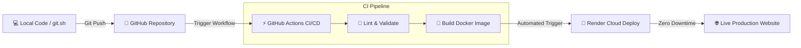

<div align="center">

# ⚡ NEELAKSHEE GHIDODE
### `Junior DevOps & Cloud Infrastructure Engineer`

[](https://neelakshee-devops-portfolio.onrender.com)
[](https://hub.docker.com)
[](https://github.com/neelakshighidode/Portfolio/actions)
[](LICENSE)

<p align="center">
  <strong>Automating Infrastructure • Engineering Scale • Continuous Delivery</strong>
</p>

---

</div>

## 📌 Overview

This repository contains the source code, containerization manifests, and automated CI/CD deployment pipelines for my personal **DevOps & Cloud Engineering Portfolio**. 

Rather than serving as a static showcase, this portfolio is built and maintained as a **production-grade DevOps implementation**—encapsulated within a lightweight Alpine Nginx container, automated via GitHub Actions, and deployed on cloud infrastructure with zero downtime.

---

## 🛠️ Core Technology Matrix

<div align="center">

| Domain | Technologies & Tools |
| :--- | :--- |
| **Operating Systems & Scripting** |    |
| **Containers & Orchestration** |    |
| **CI/CD & Version Control** |   |
| **Cloud Computing** |   |
| **Web Engineering** |    |

</div>

---

## 🏗️ DevOps Architecture & CI/CD Pipeline Flow



### 🔁 Automated Deployment Lifecycle:
1. **Developer Push:** Code changes are verified and committed using custom automated shell script (`./git.sh`).
2. **CI Pipeline Validation:** GitHub Actions triggers on every push to `main`, validating syntax and building the Docker container image.
3. **Container Delivery:** The production-optimized Nginx image is built and deployed directly to the cloud platform with live status verification.

---

## 📂 Repository Architecture

```bash
Portfolio/
├── .github/
│   └── workflows/
│       └── deploy.yml        # CI/CD GitHub Actions Pipeline
├── .dockerignore              # Files excluded from Docker context
├── Dockerfile                 # Multi-stage production Nginx Alpine image
├── docker-compose.yml         # Local container orchestration manifest
├── nginx.conf                 # Production Nginx reverse-proxy & cache config
├── git.sh                     # Automated Git staging, commit & push utility
├── index.html                 # Homepage (Hero, Terminal Matrix, Stack)
├── projects.html              # Proof of Work & DevOps project showcases
├── education.html             # Academic background & MCA timeline
├── certificates.html          # Verified cloud and container certifications
├── platforms.html             # Developer profiles & communication endpoints
├── style.css                  # Cyberpunk dark aesthetic & responsive engine
└── README.md                  # Comprehensive repository documentation
```

---

## 🚀 Quickstart: Local Container Run

Run the entire application locally using Docker in under 10 seconds:

### Prerequisites
* Docker installed and running on your system.
* (Optional) Docker Compose.

### Option 1: Using Docker Compose (Recommended)
```bash
# Clone the repository
git clone https://github.com/neelakshighidode/Portfolio.git
cd Portfolio

# Spin up the container
docker compose up -d

# Visit in your browser:
# http://localhost:8080
```

### Option 2: Using Standard Docker CLI
```bash
# Build the Docker image
docker build -t devops-portfolio:latest .

# Run the container
docker run -d -p 8080:80 --name portfolio-app devops-portfolio:latest
```

---

## ⚙️ Automated Push Script (`git.sh`)

This project includes a custom shell utility that automates safe staging, dynamic commit messages, and automated status handling:

```bash
# Make executable (Linux/WSL/Git Bash)
chmod +x git.sh

# Run the auto-push utility
./git.sh
```

---

## 📬 Connect & Collaborate

<div align="center">

[](https://github.com/neelakshighidode)
[](https://www.linkedin.com/in/neelakshee-ghidode-a85009407/)
[](https://hub.docker.com)
[](mailto:neelakshighidode24@gmail.com)

<br>

<sub>Designed & Engineered with ❤️ by <strong>Neelakshee Ghidode</strong>. Powered by modern DevOps workflows.</sub>

</div>
